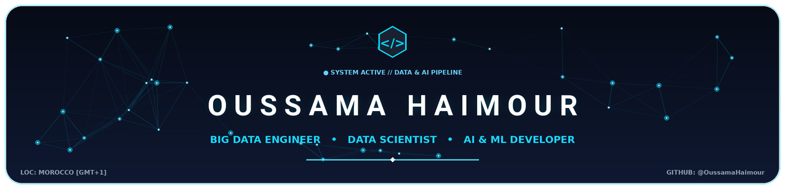
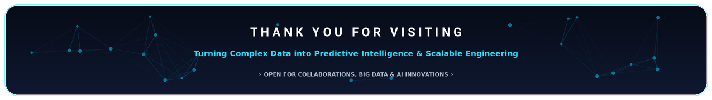

<!-- ======================================================= -->
<!-- HEADER BANNER                                           -->
<!-- ======================================================= -->
<p align="center">
  
</p>

<!-- ======================================================= -->
<!-- GREETING & MASCOT                                       -->
<!-- ======================================================= -->
<p align="center">
  
</p>

<h2 align="center">Hey there, fellow innovators! I'm Oussama Haimour 👋</h2>

<!-- ======================================================= -->
<!-- DYNAMIC TYPING SVG                                      -->
<!-- ======================================================= -->
<p align="center">
  <a href="https://git.io/typing-svg">
    
  </a>
</p>

<p align="center">
  <a href="https://github.com/OussamaHaimour">
    
  </a>
  <a href="https://github.com/OussamaHaimour?tab=repositories">
    
  </a>
  <a href="https://www.linkedin.com/in/oussama-haimour/">
    
  </a>
</p>

---

### 👨‍💻 About Me

```yaml
engineer:
  name: Oussama Haimour
  specialization: Big Data Engineering & AI/ML
  passion: Transforming raw, high-volume data into scalable predictive intelligence
  location: Morocco 🇲🇦 (GMT+1)
  core_competencies:
    - Distributed Data Architectures & ETL Pipelines
    - Applied Machine Learning & NLP Conversational Systems
    - Real-Time Financial & Demographic Analytics Dashboards
    - Modern Cloud & DevOps Automation
```

- 🔭 **What I'm Working On:** Building production-grade distributed Big Data pipelines (Hadoop, Spark) and interactive AI-driven analytics dashboards.
- 💡 **Core Interests:** Large-scale distributed computing, predictive time-series models, NLP/LLM assistants, and high-throughput data architectures.
- 💬 **Ask Me About:** Python, Apache Spark, Hadoop, Scikit-Learn, PyTorch, SQL, LangChain, and Data Engineering best practices.
- ⚡ **Philosophy:** *"Without big data, you are blind and deaf in the middle of a freeway. With it, you architect the future."*

---

### 🛠️ Technical Ecosystem

<p align="center">
  
</p>

#### 🔹 Programming & Query Languages
<p align="left">
  
  
  
  
  
  
</p>

#### 🔹 Big Data & Distributed Computing
<p align="left">
  
  
  
  
  
</p>

#### 🔹 Machine Learning, Data Science & AI
<p align="left">
  
  
  
  
  
  
  
</p>

#### 🔹 Databases, Storage & Analytics
<p align="left">
  
  
  
  
</p>

#### 🔹 DevOps, Cloud & Development Workflow
<p align="left">
  
  
  
  
  
  
  
</p>

---

### 🚀 Key Featured Projects

<table width="100%">
  <tr>
    <td width="50%" valign="top">
      <h3 align="center">📊 PLF 2026 Analytics Dashboard</h3>
      <p align="center">
        <a href="https://github.com/OussamaHaimour/plf2026-dashboard">
          
        </a>
      </p>
      <p>
        An interactive, high-fidelity analytical dashboard dissecting the <b>Moroccan Finance Bill (PLF 2026)</b>. Delivers deep budgetary breakdowns, macro-economic indicator visualizations, and trend comparisons.
      </p>
      <p>
        <b>Tech Stack:</b> <code>Python</code> <code>Streamlit</code> <code>Plotly</code> <code>Pandas</code> <code>Data Viz</code>
      </p>
      <p align="center">
        <a href="https://github.com/OussamaHaimour/plf2026-dashboard">
          
        </a>
      </p>
    </td>
    <td width="50%" valign="top">
      <h3 align="center">🧠 Wikipedia Big Data & ML Pipeline</h3>
      <p align="center">
        <a href="https://github.com/OussamaHaimour/wikipedia-bigdata-ml">
          
        </a>
      </p>
      <p>
        A distributed Big Data analytics & Machine Learning pipeline built over massive Wikipedia corpus dumps. Handles automated distributed tokenization, feature engineering, and model classification.
      </p>
      <p>
        <b>Tech Stack:</b> <code>Python</code> <code>Apache Hadoop</code> <code>PySpark</code> <code>Scikit-Learn</code> <code>NLP</code>
      </p>
      <p align="center">
        <a href="https://github.com/OussamaHaimour/wikipedia-bigdata-ml">
          
        </a>
      </p>
    </td>
  </tr>
  <tr>
    <td width="50%" valign="top">
      <h3 align="center">🤖 Chatbot HCP (National Statistics AI)</h3>
      <p align="center">
        <a href="https://github.com/OussamaHaimour/chatbot_HCP">
          
        </a>
      </p>
      <p>
        An intelligent conversational agent tailored for querying Morocco's <b>Haut-Commissariat au Plan (HCP)</b> indicators. Translates natural language questions into accurate demographic and socio-economic insights.
      </p>
      <p>
        <b>Tech Stack:</b> <code>Python</code> <code>NLP</code> <code>LangChain</code> <code>Transformers</code> <code>Vector Search</code>
      </p>
      <p align="center">
        <a href="https://github.com/OussamaHaimour/chatbot_HCP">
          
        </a>
      </p>
    </td>
    <td width="50%" valign="top">
      <h3 align="center">📈 Bitcoin BTC/MAD Financial Forecasting</h3>
      <p align="center">
        <a href="https://github.com/OussamaHaimour/Analyse-du-Bitcoin-en-Dirham-Marocain-BTC-MAD-">
          
        </a>
      </p>
      <p>
        Quantitative financial time-series analysis exploring Bitcoin market behavior converted directly into <b>Moroccan Dirhams (MAD)</b> with automated volatility modeling and trend forecasting.
      </p>
      <p>
        <b>Tech Stack:</b> <code>Python</code> <code>Time-Series Analysis</code> <code>Matplotlib</code> <code>Financial ML</code>
      </p>
      <p align="center">
        <a href="https://github.com/OussamaHaimour/Analyse-du-Bitcoin-en-Dirham-Marocain-BTC-MAD-">
          
        </a>
      </p>
    </td>
  </tr>
</table>

---

### 📈 GitHub Analytics & Activity

<div align="center">
  <table border="0" style="border: none;">
    <tr>
      <td>
        
      </td>
      <td>
        
      </td>
    </tr>
    <tr>
      <td colspan="2" align="center">
        
      </td>
    </tr>
  </table>
</div>

---

### 🐍 Contribution Activity Graph

<picture>
  <source media="(prefers-color-scheme: dark)" srcset="https://raw.githubusercontent.com/OussamaHaimour/OussamaHaimour/output/github-contribution-grid-snake-dark.svg">
  <source media="(prefers-color-scheme: light)" srcset="https://raw.githubusercontent.com/OussamaHaimour/OussamaHaimour/output/github-contribution-grid-snake.svg">
  
</picture>

---

### 🌐 Let's Connect & Collaborate

<p align="center">
  <a href="https://www.linkedin.com/in/oussama-haimour/" target="_blank">
    
  </a>
  <a href="https://github.com/OussamaHaimour" target="_blank">
    
  </a>
  <a href="mailto:oussama.haimour.pro@gmail.com" target="_blank">
    
  </a>
  <a href="https://github.com/OussamaHaimour?tab=repositories" target="_blank">
    
  </a>
</p>

<!-- ======================================================= -->
<!-- FOOTER BANNER                                           -->
<!-- ======================================================= -->
<p align="center">
  
</p>
